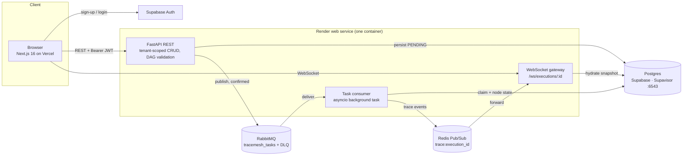
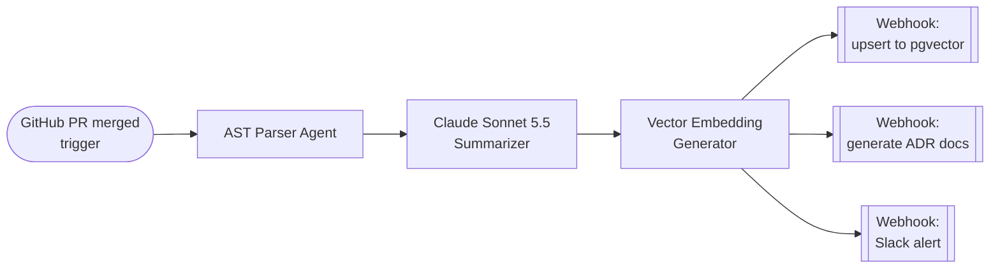

# TraceMesh

**A multi-tenant orchestrator for AI agent workflows.** Users design a DAG of triggers, agents and
webhooks on a visual canvas. TraceMesh validates the graph, runs it on a durable task queue with
at-least-once delivery and idempotent execution, and streams each node's progress to the browser
in real time.

Under the hood, TraceMesh is an async Python **modular monolith**:

- **FastAPI, SQLAlchemy 2 and asyncpg** serve a tenant-scoped REST and WebSocket API.
- **A RabbitMQ consumer** runs as a background `asyncio` task inside the same process. It claims
  each execution with an atomic conditional `UPDATE`, so duplicate deliveries are harmless.
- **Redis Pub/Sub** fans live trace events out to authenticated WebSocket clients.
- **Supabase** provides Postgres, reached through the Supavisor pooler, and Auth. Row-Level
  Security locks Supabase's public Data API out of every table.

The whole backend runs as one free-tier container. Because the consumer is a separate module that
talks to the API only through the queue, it can be split into its own service without code
changes.

**Live:** [tracemesh.vercel.app](https://tracemesh.vercel.app). The backend runs on Render's free
tier, so the first request after a period of inactivity can take up to a minute while the instance
wakes.

---

## Architecture



### How a run flows through the system

1. **Validate and persist:** `POST /workflows/{id}/execute` checks ownership and validates the DAG
   (topological sort, with cycle detection). In one transaction it writes a `PENDING` execution
   plus one `node_runs` row per node.
2. **Publish durably:** the execution payload is published as a persistent message with publisher
   confirms. If the broker doesn't confirm it, the execution is marked `FAILED` and the API returns
   503, so nothing is lost silently.
3. **Claim idempotently:** the consumer claims the run with `UPDATE … WHERE status IN
   ('PENDING','RUNNING') RETURNING`.
   - A redelivered message for a finished run changes nothing and is acked.
   - A crashed run (still `RUNNING`) is re-claimed and runs again from a clean slate.
4. **Database before telemetry:** every state change is committed to Postgres *before* its trace
   event is published to Redis. The database is therefore never behind the live stream.
5. **Stream:** the WebSocket authenticates with the first message, which keeps tokens out of
   access logs. It subscribes to Redis *before* reading the snapshot, so no event can fall between
   the two, then forwards events until the run finishes.

### Engineering decisions

| Concern | Decision | Why |
|---|---|---|
| Compute cost | Modular monolith: the consumer is an `asyncio.create_task()` inside the FastAPI lifespan | One free-tier container instead of a paid background worker; still splittable |
| Delivery | RabbitMQ manual acks, `prefetch=1`, dead-letter queue, retry once on infrastructure errors | At-least-once delivery without poison-message loops |
| Idempotency | Conditional status transitions in SQL, not in application memory | Safe under redelivery, crashes and multiple consumers |
| Shutdown | Stop consuming, drain in-flight runs for up to 20s, then leave the rest unacked | Fits Render's 30s SIGTERM window; unfinished runs are redelivered, not lost |
| Startup | The app only reports ready once the consumer is registered | A misconfigured broker fails the deploy instead of silently queueing work |
| Telemetry | Fail-open Redis publishing with a 2s timeout and per-execution sequence numbers | Observability can degrade, but it can't stall or fail an execution |
| Connection pooling | `NullPool`, no asyncpg statement cache, unique prepared-statement names | Required by Supavisor transaction mode (port 6543) |
| Tenancy | Every query filtered by the JWT's `sub`; other tenants' resources return 404 | No cross-tenant reads or ID enumeration |

## Features

- **Visual workflow builder:**
  - React Flow canvas with drag-and-drop trigger, agent and webhook nodes, renamed inline.
  - Connection rules block self-loops, duplicates and cycles as you draw, and the API enforces the
    same rules.
- **Reliable execution:**
  - Executions are queued on RabbitMQ with at-least-once delivery and handled idempotently, so
    duplicate deliveries are harmless.
  - Bad messages go to a dead-letter queue.
  - In-flight runs finish before shutdown.
- **Modular monolith backend:**
  - The RabbitMQ consumer runs concurrently with the web server, as an asyncio task inside FastAPI's
    lifespan.
  - A single instance runs the whole backend.
  - The worker stays a separate module that can also run as its own process.
- **Live run status:**
  - Each node's progress is recorded in Postgres, then published over Redis Pub/Sub.
  - The browser receives a snapshot over an authenticated WebSocket, then the live stream, so the
    view is correct even when it joins mid-run.
- **Accounts:** sign-up with password confirmation and an email verification code, sign-in, and
  password reset (Supabase Auth).
- **Workflow management:** create, rename and delete workflows from the dashboard.
- **Multi-tenant security:**
  - **Authenticated requests:** every REST route and WebSocket verifies the user's Supabase JWT.
    - The algorithm selects the key: HS256 uses the secret, and ES256/RS256 use the project JWKS.
    - Audience, expiry and issuer are checked.
  - **Scoped queries:** every query is filtered by the caller's user ID, and other users' resources
    return 404.
  - **Database constraints:** composite foreign keys stop an edge from linking nodes in different
    workflows.
  - **Supabase Data API lockdown:** Row-Level Security is enabled on every table with no policies,
    and `anon`/`authenticated` grants are revoked, so the public Supabase REST API can't read or
    write tables.
    - The backend connects as the table owner, so tenant isolation for its own queries comes from
      the application layer above.
    - A CI test fails if any table lacks RLS.

## Example AI/ML workflow: automated codebase onboarding and RAG pipeline

This example shows the kind of pipeline TraceMesh is built to orchestrate. When a pull request
merges, it turns the changed code into searchable knowledge and documentation.



| Step | Node type | Responsibility |
|---|---|---|
| **GitHub PR merged** | `trigger` | Receives the merge event, with repository, PR number and changed files |
| **AST Parser Agent** | `agent` | Parses changed files into syntax trees and extracts modules, classes, functions and call relationships as structured chunks |
| **Summarizer** | `agent` | An LLM (Claude Sonnet 5.5) writes a concise, architecture-aware summary of each chunk and of the PR as a whole |
| **Vector Embedding Generator** | `agent` | Embeds each summary and code chunk for semantic retrieval |
| **Upsert to pgvector** | `webhook` | Writes embeddings and metadata to a `pgvector` index that backs a RAG assistant for the codebase |
| **Generate ADR Docs** | `webhook` | Drafts an Architecture Decision Record from the PR summary for review |
| **Slack Alert** | `webhook` | Notifies the team channel with the summary and links |

How TraceMesh runs this graph:

- **Validation on save:** the embedding step fans out into a Y-branch of three webhooks. This is
  valid because every edge write is validated: no cycles, no self-loops, no duplicates, and no
  edges across workflows.
- **Ordering:** on execute, the DAG is sorted topologically and deterministically, so every
  dependency finishes before its dependents start.
- **Visibility:** each node's `RUNNING`/`COMPLETED`/`FAILED` state is persisted and streamed live.
  An engineer watching the canvas sees exactly where a run is, or where it failed and why.
- **Crash recovery:** if the container restarts mid-run (for example on a deploy), the message is
  redelivered and the pipeline is re-claimed and re-run.

> **Implementation status:** the orchestration layer is complete: DAG validation, durable queueing,
> idempotent execution, persisted per-node state and live streaming. Today, node *execution* is
> simulated (one second per node, with an optional injected failure), and nodes run sequentially
> in topological order, so the three webhook branches run one after another rather than in
> parallel. Real executors (LLM calls, outbound webhooks) and parallel branch execution are on the
> [roadmap](docs/MASTER_PLAN.md).

## Tech stack

| | |
|---|---|
| Frontend | Next.js 16 (App Router), React 19, TypeScript, Tailwind CSS 4, React Flow 12, `@supabase/ssr` |
| Backend | Python 3.12, FastAPI, SQLAlchemy 2 (async, asyncpg), Alembic, aio-pika, redis-py |
| Infrastructure | PostgreSQL + Auth (Supabase), RabbitMQ (CloudAMQP), Redis (Upstash) |
| Hosting | Vercel (frontend), Render (backend, Infrastructure as Code via `render.yaml`) |
| Testing / CI | Pytest, pytest-asyncio, httpx-ws, fakeredis; GitHub Actions with Postgres 16 |

See [docs/ARCHITECTURE.md](docs/ARCHITECTURE.md) for components, data flows and guarantees, and
[docs/MASTER_PLAN.md](docs/MASTER_PLAN.md) for the roadmap.

## Repository layout

```
backend/
  app/            FastAPI app, task consumer (worker), broker, telemetry, models
  alembic/        database migrations
  tests/          pytest suite (real Postgres, mocked RabbitMQ and Redis)
frontend/
  src/app/        Next.js routes (auth pages, /workflows dashboard, /workflows/[id] canvas)
  src/components/ canvas, nodes, auth forms, dashboard
  src/proxy.ts    session refresh and route protection
docs/             architecture, roadmap, engineering journal
render.yaml       Render Blueprint for the backend
```

## Local development

### Prerequisites
- Python 3.12 and Node.js 20.9+ (required by Next.js 16).
- A Supabase project: Postgres plus Auth.
- A RabbitMQ broker: CloudAMQP's free tier, or local `docker run -p 5672:5672 rabbitmq:3`.
- A Redis instance: Upstash's free tier, or local `docker run -p 6379:6379 redis:7`.

### 1. Backend
```bash
cd backend
python3.12 -m venv tracemesh-env
tracemesh-env/bin/pip install -r requirements-dev.txt
cp .env.example .env          # fill in DATABASE_URL, SUPABASE_JWT_SECRET, SUPABASE_URL, RABBITMQ_URL, REDIS_URL
tracemesh-env/bin/alembic upgrade head
```

> [!WARNING]
> **Environment variable gotchas.** These cause the most common setup failures:
>
> - **`DATABASE_URL` passwords must be URL-safe.**
>   - Characters such as `@`, `:`, `/`, `#`, `?` or `%` in the password break URL parsing, so
>     SQLAlchemy and asyncpg fail at startup with confusing host or authentication errors.
>   - Use a strictly alphanumeric database password, or percent-encode the reserved characters
>     (`@` → `%40`).
>   - Use the `postgresql+asyncpg://` scheme with the Supavisor **transaction-mode** URL on port
>     **6543**.
> - **`CORS_ORIGINS` must be the exact browser origin.**
>   - Use a raw URL with scheme and host only, with no trailing slash, no path and no surrounding
>     brackets or quotes, e.g. `https://tracemesh.vercel.app`. Separate multiple origins with
>     commas. The API also accepts a JSON list, and strips stray whitespace and trailing slashes.
>   - A mismatch makes every preflight fail with `400 Disallowed CORS origin`.
>   - The API logs the origins it loaded at startup (`CORS allowed origins: [...]`), so check that
>     line first.

### 2. Frontend
```bash
cd frontend
npm install
cp .env.example .env.local    # fill in NEXT_PUBLIC_SUPABASE_URL and NEXT_PUBLIC_SUPABASE_ANON_KEY
```

### 3. Supabase Auth settings (dashboard)
- **Email templates:** add `{{ .Token }}` to the *Confirm signup* and *Reset password* templates,
  so users receive a code. The links in those emails also work.
- **Redirect URLs:** under URL Configuration, add `http://localhost:3000/auth/confirm`.
- **SMTP:** the built-in mailer only delivers to project team members and is rate-limited. Configure
  custom SMTP before inviting other users.

### 4. Run it (two terminals)
```bash
# Backend: API and task consumer in one process — http://127.0.0.1:8000 (docs at /docs)
cd backend && tracemesh-env/bin/uvicorn app.main:app --reload

# UI — open http://localhost:3000
cd frontend && npm run dev
```

The backend needs only one terminal: FastAPI's lifespan starts the RabbitMQ consumer as a
background asyncio task, so the API process also runs executions. Running the consumer
separately is optional, for example to test with several consumers:
`cd backend && tracemesh-env/bin/python -m app.worker`. Extra consumers share the queue safely.

Open the app at `http://localhost:3000`, not `127.0.0.1:3000`: the API's `CORS_ORIGINS` allows
`http://localhost:3000` by default. The API won't start if it can't reach RabbitMQ.

### Tests
The backend suite needs a disposable local Postgres. RabbitMQ and Redis are mocked:

```bash
docker run -d --name tm-test-db -e POSTGRES_PASSWORD=postgres -e POSTGRES_DB=tracemesh_test -p 5432:5432 postgres:16
cd backend && tracemesh-env/bin/pytest
```

The suite has 140 tests:
- It uses real Postgres, because the constraints, JSONB, enums and conditional updates are part of
  what's under test.
- The schema is built by the real Alembic migrations.
- It also covers the in-process consumer's startup, drain and cancellation, and CORS preflights.
- It refuses to run against any database that isn't local or whose name doesn't contain `test`,
  because it truncates tables. Set `TEST_DATABASE_URL` to use a different database.
- CI runs the same suite on every PR that touches `backend/`.

Frontend checks:
```bash
cd frontend && npm run lint && npx tsc --noEmit && npm run build
```

## Deployment

Production runs entirely on free tiers:

| Layer | Platform | Details |
|---|---|---|
| Frontend | **Vercel** | Next.js 16 from `frontend/`. Set `NEXT_PUBLIC_SUPABASE_URL`, `NEXT_PUBLIC_SUPABASE_ANON_KEY`, and `NEXT_PUBLIC_API_URL` (the Render URL; WebSockets derive `wss://` from it) |
| Backend | **Render** | One web service (`tracemesh-backend`) defined in [`render.yaml`](render.yaml): Python 3.12.4, `plan: free`, `/health` health check. It runs the API, the WebSocket gateway and the task consumer in one process |
| Database + Auth | **Supabase** | Postgres through the **Supavisor connection pooler in transaction mode (port 6543)**, with Supabase Auth issuing the JWTs the API verifies |
| Queue | **CloudAMQP** | Managed RabbitMQ, a durable `tracemesh_tasks` queue with a dead-letter queue |
| Pub/Sub | **Upstash** | Managed Redis over TLS (`rediss://`) for live trace fan-out |

**Why port 6543:**
- Supavisor's transaction mode multiplexes many client connections onto a small pool of Postgres
  connections. That suits a free-tier database's connection limits.
- Because consecutive statements can land on different backend connections, the engine is
  configured accordingly: SQLAlchemy uses `NullPool` (Supavisor does the pooling), asyncpg's
  prepared-statement cache is disabled, and every prepared statement gets a unique name.
- Without these settings, the pooler raises `prepared statement already exists` errors under load.

**Render specifics:**
- **Migrations:** the build command runs `alembic upgrade head`, because Render's pre-deploy
  commands are only available on paid plans.
- **Why one service:** Render's free tier has no background workers, which is why the consumer
  lives inside the web service.
- **Shutdown:** on each deploy, the old instance drains in-flight runs before exiting.
- **Secrets:** set `DATABASE_URL`, `RABBITMQ_URL`, `REDIS_URL`, `SUPABASE_URL`,
  `SUPABASE_JWT_SECRET` and `CORS_ORIGINS` in the Render dashboard. They're declared `sync: false`,
  so their values never live in the repository.

**Supabase Auth for production:**
- Set the Site URL to the Vercel domain.
- Add `https://<domain>/auth/confirm` to the Redirect URLs.
- Configure custom SMTP.
